# GCOS Personalization — Architecture & Current Engineering Work

> **Engineering architecture / implementation handoff**  
> **Updated:** 26 October 2026  
> **Current goal:** First real personalized image through **Node.js → Python → Vertex AI → private GCS**.  
> **Scope:** Current repository baseline + agreed target architecture + implementation work in GitHub issues.  
> **Evidence rule:** An issue, design, or architecture review is not proof that a feature is implemented. Completion requires PRs, automated tests, and, where applicable, live GCP verification.

**Navigation:** [System](#1-system-at-a-glance) · [Current work](#2-what-we-are-doing-right-now) · [Components](#3-service-responsibilities) · [Generation](#4-how-image-generation-works) · [GCS](#5-gcs-storage-and-data-ownership) · [Identity](#6-authentication-and-owner-isolation) · [Contract](#7-node--python-contract) · [Skills](#8-skills-and-guardrails) · [Failures](#9-retries-recovery-and-consistency) · [Delivery](#10-delivery-plan-and-exact-issue-ownership) · [Open items](#11-verification-checklist-and-open-decisions)

---

## 1. System at a glance

We are evolving the existing GCOS Create Image experience into a **Google Cloud-based, user-scoped image personalization service**. A user provides a prompt and, in later milestones, reference assets, selected Skills, Brand context, and model settings. The backend controls authorization and storage. The Python service performs approved image-generation operations with Google Vertex AI/Gemini. GCS stores private original images, outputs, and JSON application records.

The system remains **backend-orchestrated**; this plan does not introduce Google ADK as a separate orchestrator, or Firestore/BigQuery as new application storage.

### 1.1 Developer system overview


**Diagram 1 — Responsibility boundaries (target architecture)**

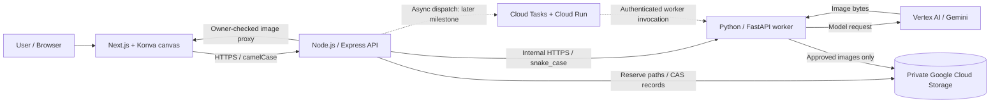

**Line meanings:** solid lines = main logical request/data path; dashed lines = later deployed asynchronous path. Node is the authority for user identity, authorized references, reserved output names, and authoritative job state. Python never independently chooses the user's GCS namespace.

### 1.2 Existing vs. being built

| Area | Present in supplied code snapshot | Implementation we are working toward |
|---|---|---|
| Frontend | Next.js 15 canvas/Konva, Create Image interface, local user-managed Skills | Authenticated request submission, status/results on canvas, optional references and versioned Skills |
| Node.js backend | Express API, session/auth middleware, GCS helper reading `GCS_BUCKET_NAME` | Verified `iss`/`sub`, owner-key, generation contract validators, GCS reservations/CAS, private image proxy |
| Python backend | FastAPI, Campaign-oriented execution pipeline, Vertex components, workflow/Skill registry | Independent job execution contract, direct generation smoke, reserved-slot output writer, callbacks |
| Storage | GCS integration helper exists; full target server-side state not confirmed in provided snapshot | Private development bucket; object-based state/indexes/assets with safe conditional writes |
| Async execution | No claim of completed new task/lease integration | Local async first; Cloud Tasks/Cloud Run and worker fencing for staging |
| Skills/guardrails | Frontend Markdown Skills and Python prompt-rule registry | Node-authorized version-pinned Skills and independent mandatory Python validation |

**Current status:** the architecture and issue plan are prepared. The real bucket, integrated routes, shared validators, and live smoke must be verified from implementation PRs and actual test logs. Avoid labeling them complete based on review comments alone.

---

## 2. What we are doing right now

The immediate milestone is **M1 — one real image generated in a local direct CLI smoke test**, written to a reserved GCS object and verified by Node. **M1 is not yet the 1–10 image async browser demo.**

### 2.1 Five independent starting issues

| Issue | Actual engineering work | Output needed before marking complete |
|---|---|---|
| [#352 NJS-01](https://github.com/AbhimanyuPd/GCOS-personalization/issues/352) | Inspect Node routes, auth, storage helper, feature flags and current behavior | Code-path inventory and integration ownership map |
| [#353 PY-01](https://github.com/AbhimanyuPd/GCOS-personalization/issues/353) | Inspect Python runtime, legacy Campaign dependencies and reusable Vertex client | File-path inventory and validated reuse boundaries |
| [#354 SH-01](https://github.com/AbhimanyuPd/GCOS-personalization/issues/354) | Implement canonical shared JSON fixtures and SHA-256 manifest | `docs/contracts/generation/v1/` + same pinned fixtures for both teams |
| [#355 GCS-01](https://github.com/AbhimanyuPd/GCOS-personalization/issues/355) | Provision/configure/test the real private development bucket | Bucket/IAM evidence; upload, read, create-only and `412` conflict logs |
| [#361 NJS-04A](https://github.com/AbhimanyuPd/GCOS-personalization/issues/361) | Migrate auth to verified issuer/subject and derive stable owner-key | Session/JWT changes, no email fallback, isolation tests and secret configuration |

**Scheduling:** these start **in parallel**. #354 feeds #356/#357. #355, #356 and #361 gate #367. The isolated smoke also needs Python output writing, real Python generation, and Node direct client integration.

### 2.2 The shortest implementation path

**Diagram 2 — M1 dependencies (solid = hard code/merge prerequisite)**

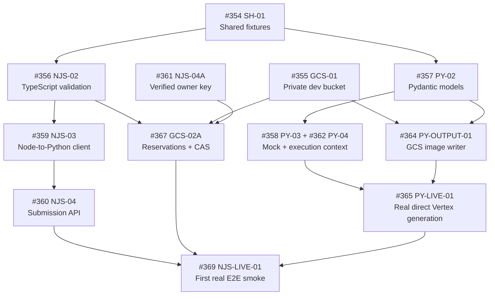


### 2.3 Current sprint output, in plain English

1. **Provision GCS** with private controls. Prove that duplicate create-only writes fail, rather than relying on configuration screenshots.
2. **Freeze one service contract** in JSON fixtures. Keep browser camelCase and Node↔Python snake_case, with exactly six job statuses.
3. **Make identity safe for storage**: verified Google issuer and `sub`, stable HMAC `owner_key`, explicit re-login for old email-only sessions.
4. **Implement both validators** from the same fixture revision, then add GCS reservation and Python upload code.
5. **Run the first real image test**: Node authorizes and reserves, Python generates through Vertex, output lands at the reserved path, Node checks bytes/metadata.

No production-ready browser workflow is claimed at this stage.

---

## 3. Service responsibilities

### 3.1 Ownership map

| Component | Owns | Must not do |
|---|---|---|
| **Frontend — Next.js/Konva** | Prompt/asset/Skill selection, request UI, progress and image display | Construct raw owner keys, write private GCS objects, act as storage authority |
| **Node API — Express** | Authentication, authorization, ID allocation, contract boundary, request admission, job state, output reservation, private proxy, idempotency | Trust client-provided owner namespace or generated output path |
| **Python worker — FastAPI** | Pydantic validation, model context, Skills/guardrail execution, Vertex calls, output encoding, approved create-only upload and worker callbacks | Own job state, pick arbitrary GCS paths, update Node-owned state records |
| **GCS** | Private images and JSON records; generation-based CAS/object preconditions | Enforce application-level user ownership solely through object prefixes |
| **Cloud Tasks / Cloud Run** | Later deployed async dispatch, at-least-once delivery, private worker invocation | Replace Node authorization, job fencing, or idempotency checks |

### 3.2 Logical layers inside the services

**Diagram 3 — Component-level target design**

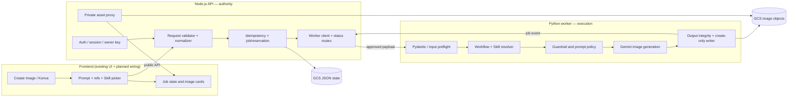

**Important scope:** some target modules here are issue-assigned, not already active in the checked-in code snapshots.

---

## 4. How image generation works

We deliberately split **M1 direct smoke** from **M2 local async canvas** and **M4 deployed async**. The three paths share the contract and storage invariants, but not identical admission/dispatch behavior.

### 4.1 First real image — local direct smoke (M1)

**Diagram 4 — Count=1, no global job indexes**

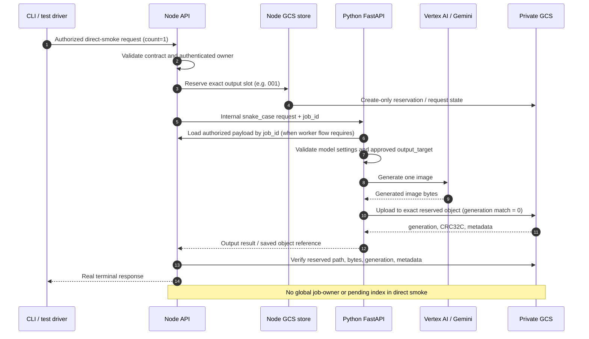

The real smoke must use an approved Vertex model ID/region and valid Google credentials. A successful fake or mock response is **not** evidence that generation works.

### 4.2 Later 1–10 image flow — local async and deployed async


**Diagram 5 — Durable async lifecycle (planned)**

```mermaid
sequenceDiagram
    autonumber
    participant B as Browser
    participant N as Node API
    participant G as GCS JSON / assets
    participant Q as Dispatcher / Cloud Tasks
    participant P as Python worker
    participant V as Gemini
    B->>N: POST execute (camelCase, count 1..10)
    N->>N: Auth + idempotency + schema validation
    N->>G: Create request, job, output reservations, indexes
    G-->>N: Durable generations / records
    N->>Q: Dispatch immutable job_id
    N-->>B: HTTP 202 + job_id / status URL
    Q->>P: Internal authenticated job dispatch
    P->>N: Claim lease / obtain fencing token
    N->>G: CAS lease / job state
    N-->>P: Authorized payload + reserved output targets
    loop Each output slot (1 to 10)
        P->>V: Generate / edit image
        V-->>P: Result or failure
        alt Image generated
            P->>G: Create-only reserved output + metadata
            P->>N: output_saved callback (fencing token)
            N->>G: Verify output and commit state via CAS
        else Slot failed
            P->>N: slot_failed callback
            N->>G: Record failure / attempt details
        end
    end
    P->>N: job_finalized callback
    N->>G: CAS terminal status; retire pending marker
    B->>N: GET authenticated job status
    N-->>B: completed / partial_success / failed + outputs
    B->>N: GET authenticated image proxy
    N->>G: Read owned, verified asset
    N-->>B: Image bytes
```

At this stage, the frontend should show **per-slot** success/failure rather than assume every requested image exists. Cloud Tasks is at-least-once; the CAS/lease/fencing logic, not queue delivery alone, prevents stale workers from corrupting job state.

### 4.3 Execution modes are different contracts

| Mode | Typical purpose | Output count | Dispatch | Job indexes |
|---|---|---:|---|---|
| `mock` | UI and service development without paid model call | No real output | No real worker | None |
| `local_direct_smoke` / Python direct | First real integration test | **1** | Synchronous test path | **None** |
| `local_async` | Canvas demo with 1/3/10 images | 1–10 | Local durable dispatcher | Required |
| Deployed async | Staging/production pattern | 1–10 | Cloud Tasks / private Cloud Run | Required |

---

## 5. GCS storage and data ownership

The proposed development configuration is **one private GCS bucket** using the existing Node variable `GCS_BUCKET_NAME`. `v1/` prefixes separate concerns logically; these prefixes **do not themselves create IAM security boundaries**. More restrictive identities or separate buckets require actual configuration/verification.

### 5.1 Physical and logical data map


**Diagram 6 — GCS write authority**

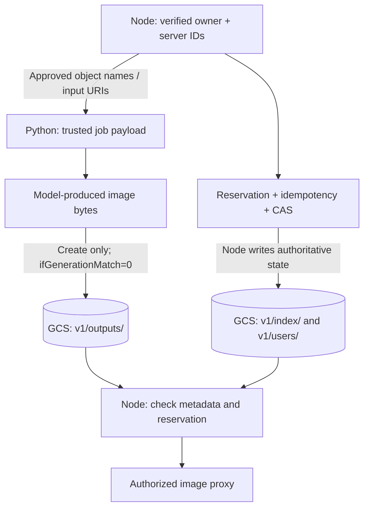

### 5.2 Canonical object naming

```text
# Node-owned JSON / authoritative application state
v1/index/jobs/{job_id}.json
v1/index/pending/{job_id}.json
v1/users/{owner_key}/requests/{request_id}/request.json
v1/users/{owner_key}/jobs/{job_id}/job.json
v1/users/{owner_key}/jobs/{job_id}/outputs/{output_id}.json
v1/users/{owner_key}/assets/{asset_id}/manifest.json
v1/users/{owner_key}/idempotency/{sha256_of_key}.json
v1/users/{owner_key}/sessions/{session_id}/session.json
v1/users/{owner_key}/skills/{skill_id}/versions/{version}.md
v1/users/{owner_key}/skills/{skill_id}/latest.json
v1/users/{owner_key}/brands/{brand_id}/versions/{version}.json
v1/users/{owner_key}/brands/{brand_id}/latest.json

# Image objects — private inputs and outputs
v1/inputs/users/{owner_key}/assets/{asset_id}/original.{ext}
v1/inputs/users/{owner_key}/brands/{brand_id}/references/{asset_id}.{ext}
v1/outputs/users/{owner_key}/requests/{request_id}/slots/{slot_padded}-{asset_id}.{ext}
```

**Slot conventions:** `001`–`010` (three-digit, reserved by Node before generation). The object name includes the request/slot/asset identities; **not** the changing attempt ID. Output records can link an object to `attempt_id` for audit.

### 5.3 Storage operation contract

| Operation | Owner | Required safety mechanism |
|---|---|---|
| Create request / output reservation | Node | Authenticated user + create-only precondition |
| Update mutable job / pointer | Node | CAS with previously read GCS generation |
| Claim/renew worker lease | Node, via authenticated worker API | Generation-match CAS + fencing token |
| Upload generated image | Python | Exact reserved name, `ifGenerationMatch=0`, checksum and custom metadata |
| Handle unexpected upload `412` | Python + Node | Re-read existing reserved object and reconcile; never overwrite blindly |
| Serve output to frontend | Node | Owner verification, reservation/manifest lookup, private binary proxy |
| Remove pending marker | Node | Conditional deletion; stale marker recovered by scanner |

**Real GCS-01 validation:** upload succeeds, readback matches, first create-only write succeeds, repeated create-only write produces an HTTP **412**, and configured IAM identities are checked. Retention/lifecycle approvals are separate from these technical smoke tests.

---

## 6. Authentication and owner isolation

Current email-only session identity is insufficient as a stable GCS object namespace. #361 updates the Node sign-in/session path to carry **verified Google `iss` and `sub`**, and makes legacy email-only sessions reauthenticate. No email fallback is permitted.

### 6.1 Verified owner-key derivation

**Diagram 7 — Trust boundary before any GCS write**

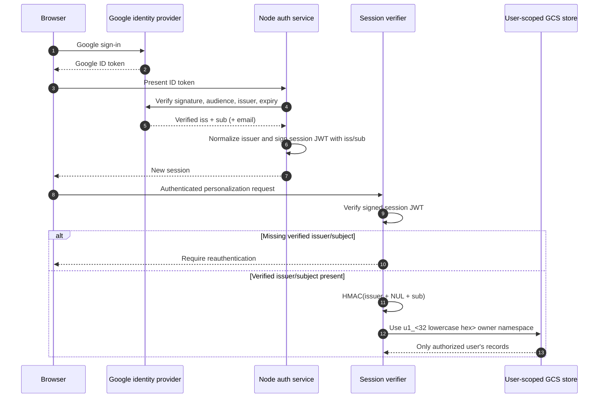

```text
owner_key = "u1_" + first_32_hex(
    HMAC_SHA256(OWNER_KEY_HMAC_V1, normalized_issuer + "\0" + verified_sub)
)
```

The `OWNER_KEY_HMAC_V1` secret is Node-only, 256-bit, environment-managed and never sent to Python/browser. Its rotation requires a deliberate migration strategy. An `owner_key` is a **storage namespace**, not itself proof of authorization.

### 6.2 Security requirements we must preserve

- Private GCS bucket, Public Access Prevention and Uniform Bucket-Level Access.
- Node trusts verified provider issuer/subject, never a browser-supplied owner key, email-derived ID, or spoofed header.
- Python receives only Node-authorized job payloads, approved input URIs and exact reserved output paths.
- Internal dispatch, claims and callbacks are authenticated; lease/fencing tokens protect stale-worker writes to state.
- No public output-object URLs or unreviewed signed image URL exposure; image delivery is through the authorized Node proxy.
- An anonymous session must not become a shared owner of paid model requests or durable GCS assets.

---

## 7. Node ↔ Python contract

SH-01 produces **one fixture library**, consumed by independent validators in Node and Python. It is a wire contract, **not** the owner of every Node-only GCS record schema.

### 7.1 Where fields change case

**Diagram 8 — Contract boundary**

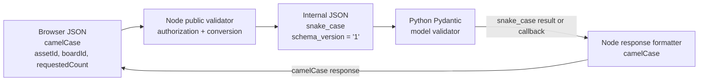

- The **browser request** is camelCase and carries **no request schema-version field**.
- Public accepted/status **responses** may contain the specified `schemaVersion` field.
- Node↔Python messages use `snake_case` and `schema_version: "1"` (**string**, not integer).
- Node uses handwritten TypeScript validators (no Zod requirement); Python uses Pydantic. Both must **accept/reject the same canonical fixtures**.
- Canonical fixtures remain under `docs/contracts/generation/v1/` with flat files, `invalid/`, and `fixtures.sha256`; `APPROVED_PRIVATE_ASSET_BUCKET` is a fixture placeholder.
- Sample IDs such as `req_001`, `job_001` remain compatible with the v1 fixture regex; avoid introducing an implicit ULID-only breaking change.

### 7.2 Fixed job statuses

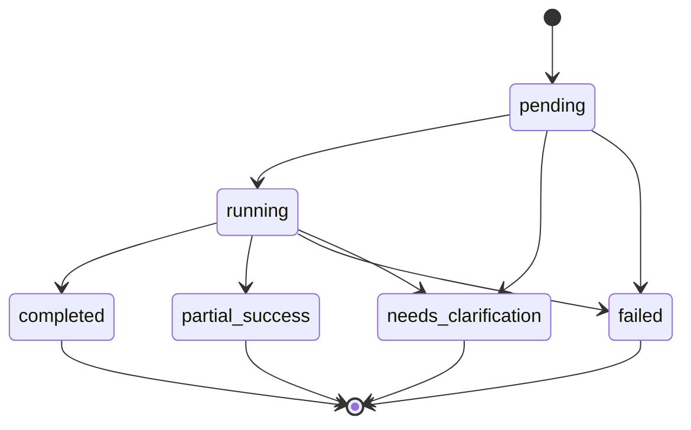

The six **public** statuses are **`pending`**, **`running`**, **`completed`**, **`partial_success`**, **`failed`**, **`needs_clarification`**. Internal dispatch flags are not additional public states. Terminal-state semantics, transitions, HTTP mappings and per-slot statuses are governed by the canonical contract; the state diagram is an overview, not a replacement for contract fixtures.

### 7.3 Required shared fixture categories

| Category | Representative content |
|---|---|
| Requests | Public camelCase + internal snake_case; six approved image roles; null board/session; 1 and 10 image boundaries; model settings; at most five Skills |
| Execution modes | Mock with no fabricated image and no polling; `python_direct` results; local direct no-index; local async accepted/terminal |
| Worker protocol | Dispatch accepted/finalized/already-running, lease acquire/renew, stale lease negative |
| Callbacks | `attempt_started`, `slot_failed`, `clarification_required`, `output_saved`, `attempt_finished`, `job_finalized` |
| Errors and retries | Full named errors, failed-slot retry request/accepted, invalid cases, hash mismatch |
| Index fixtures | `state.index.job_owner.json`, `state.index.pending.json` (Node-private records but pinned in the shared fixture set) |

**Implementation split:** SH-01 = fixture bytes/README/hash; NJS-02 = handwritten TS models/validators; PY-02 = Pydantic models; individual storage issues define their own Node-only records.

---

## 8. Skills and Guardrails

Skills let users customize *how* generation should be performed. Guardrails limit *what may change* and ensure critical brand/product/user constraints are not bypassed by optional instructions.

### 8.1 Three different layers — do not conflate them

| Layer | Today in supplied snapshot | Target implementation |
|---|---|---|
| **Frontend Markdown Skills** | Local user-managed Skills UI | Authorized, GCS-backed immutable Markdown versions resolved by Node |
| **Python built-in prompt locks** | `config/skills.json`: 19 named rules; registry selects by operation/condition | Reuse and adapt task-relevant rules in the new job execution flow |
| **Mandatory enforcement/QA** | Deterministic and semantic validation components exist, but a complete new independent gate is not proven | Mandatory Python guardrail checks, policy-conflict rejection, audit trail and validated output checks |


### 8.2 Planned trusted prompt assembly

**Diagram 9 — Selection, enforcement, and generation**

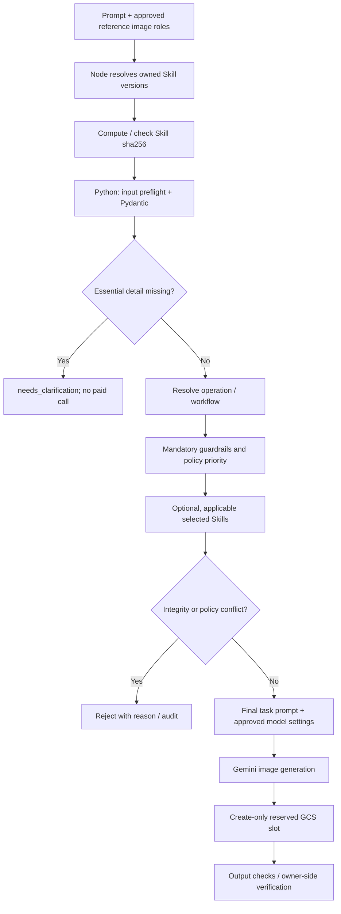

**Trust rule:** a selected Skill cannot override mandatory preservation, authorization, or safety policy. A hash mismatch is an `integrity_error`, not a silently ignored Skill. Manual Skill selection is the first planned milestone; automatic suggestions are explicitly deferred.

### 8.3 The 19 Python built-in prompt-rule IDs observed in the snapshot

| Group | Rule IDs |
|---|---|
| Product fidelity | `product_lock`, `product_lock_v2`, `scale_lock`, `total_erasure` |
| Identity / edit region | `identity_lock`, `geometry_lock`, `border_lock`, `region_edit_guards`, `background_only` |
| Brand / logo | `brand_dna`, `brand_palette`, `logo_lock`, `logo_space` |
| Audience / quality | `audience_personalization`, `photoreal_quality` |
| Placement / studio | `product_placement_guards`, `studio_presentation`, `white_studio` |
| Text protection | `no_text` |

These are **prompt-rule configuration entries**, not nineteen independently proven image-quality classifiers. They are chosen by workflow, applicability and suppression rules; not all nineteen are applied on every request.

**Example operation-specific handling:**

- **Background change:** preserve main subject/product; activate `product_lock_v2` and `region_edit_guards` where specified by the workflow.
- **Product swap:** preserve scene and correct product placement; use workflow-specific region/product guards.
- **Studio presentation:** use `studio_presentation` / `white_studio`; suppress incompatible background-change and palette locks as configured.
- **Audience personalization:** apply `audience_personalization` only when appropriate campaign/audience facts exist.

### 8.4 Skill work is later than the first real image

| Issue | Planned code responsibility |
|---|---|
| [#378 NJS-07](https://github.com/AbhimanyuPd/GCOS-personalization/issues/378) | Immutable GCS Markdown Skill versions and latest pointer |
| [#379 FE-02](https://github.com/AbhimanyuPd/GCOS-personalization/issues/379) | Selected-Skill picker in Create Image |
| [#380 NJS-08](https://github.com/AbhimanyuPd/GCOS-personalization/issues/380) | Resolve owner-authorized pinned Skill content for Python |
| [#381 PY-06](https://github.com/AbhimanyuPd/GCOS-personalization/issues/381) | Verify hash, applicability, conflicts and applied/skipped/rejected outcomes |
| [#382 PY-07](https://github.com/AbhimanyuPd/GCOS-personalization/issues/382) | Mandatory independent Python guardrails |
| [#383 PY-08](https://github.com/AbhimanyuPd/GCOS-personalization/issues/383) | Prompt understanding and clarification |
| [#384 PY-09](https://github.com/AbhimanyuPd/GCOS-personalization/issues/384) | Compose final campaign-independent prompt package |

---

## 9. Retries, recovery and consistency

One request can reserve **1–10 immutable output slots**. A generation attempt is not the same thing as a verified delivered image. Model requests can fail, responses can time out, and a GCS upload can succeed even if the worker loses its acknowledgment.

### 9.1 Create-only upload and `412` reconciliation

**Diagram 10 — Race-safe output handling**

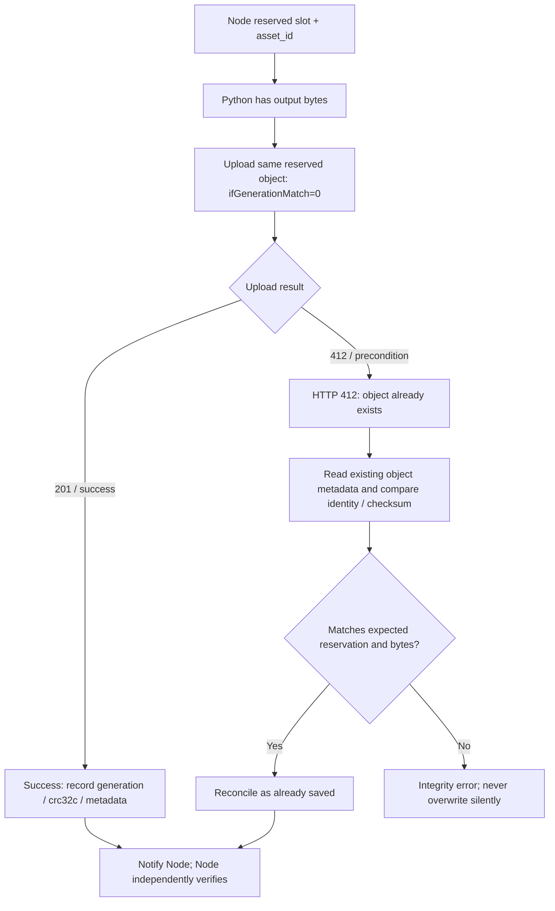

### 9.2 Failed-slot retry is a new child job

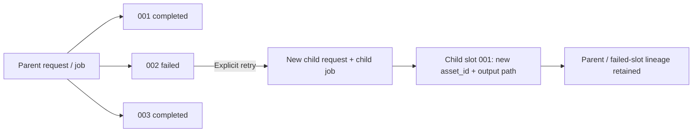

The retry does **not** overwrite parent slot `002`. The child job has separate idempotency/admission, output reservation and, for async retries, its own job-owner/pending indexes. The parent remains auditable.

### 9.3 Worker leases and stale-worker prevention

Lease claims/renewals carry fencing tokens. Node checks the current lease and uses GCS conditional writes for authoritative state. Async jobs need immutable global `job_id → owner_key` mapping because workers only receive `job_id`. A global pending marker is a recovery hint—not a public status. #368 owns lease persistence and requires a concurrency test with **ten slots completing simultaneously**.

---

## 10. Delivery plan and exact issue ownership

### 10.1 Four milestones

**Diagram 11 — Delivery scope (not time estimates)**

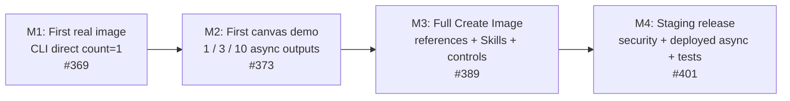

| Milestone | Observable success | Important dependencies |
|---|---|---|
| **M1** | Local Node↔Python real image, reserved private GCS path, verified result | #354, #355, #361, #356/#357, #364, #367, #365, #369 |
| **M2** | One/three/ten image results visible on canvas with durable local async | #368, #366, #372, #371, #373 |
| **M3** | Real reference assets, selected versioned Skills, model settings | #374/#375/#376, #378–#381, #389 |
| **M4** | Private Cloud Run workers, Cloud Tasks, guardrails, Brand context, retries, staging gates | #390–#401 and linked dependencies |

### 10.2 Ownership by repository

```text
Node.js repository
  SH-01 canonical fixtures (initial master)
  NJS-01 / NJS-02 / NJS-03 / NJS-04 / NJS-04A
  GCS-01 setup reference, GCS-02A / GCS-02B state
  Identity, request admission, sessions, Skills / Brand versions
  Private output proxy and final browser API

Python repository
  PY-01 / PY-02 / PY-03 / PY-04
  PY-OUTPUT-01 and PY-LIVE-01
  Pydantic worker request, model calls, conditional output upload
  Skill verification, mandatory guardrails, prompt package
  Async callbacks / tracing / production worker later

Cloud / security owner
  GCP project, allowed model + region, bucket, IAM identities
  Secret Manager access, retention approvals, Cloud Tasks/Run setup
  Live permission and deployment evidence
```

### 10.3 What Claude Code can implement without cloud access

Claude can implement **SH-01 fixture files + hash tool**, **NJS-04A code + unit tests using disposable secrets**, **NJS/PY validators**, local mock clients, GCS infrastructure scripts and documentation, plus unit tests with fakes. Claude must **not** claim the bucket is provisioned, IAM is correct, or Gemini images were generated until actual GCP-backed tests have run.

### 10.4 Explicitly not the immediate sprint

A production Cloud Tasks queue, full 10-image canvas, server-side Skills/Brand migration, Agent auto-selection, high-reliability image QA, multi-service deployed staging, and deleting legacy Firestore paths are tracked separately. Do not pull them into #354/#355/#361 simply because they appear in the long-term architecture.

---

## 11. Verification checklist and open decisions

### 11.1 What counts as real completion

- [ ] **GCS:** Project/bucket/region recorded; access tested from intended identities; private settings confirmed; upload and read verified; duplicate `ifGenerationMatch=0` fails with 412.
- [ ] **Contract:** Required fixtures committed, `fixtures.sha256` stable, Node and Python pass the same valid/invalid cases, matching revision documented.
- [ ] **Identity:** New signed sessions contain verified `iss`/`sub`; old email-only sessions re-login; deterministic `owner_key`, tests for cross-user access denial.
- [ ] **Reservation:** Node generates and reserves exact private GCS path and prevents path overrides.
- [ ] **Python output:** Real approved Gemini result uploaded to that exact path with expected checksum and output metadata; 412 reconciliation tested.
- [ ] **Integration:** One authenticated count=1 Node→Python→GCS CLI test passes; Node reads and verifies the actual stored object.
- [ ] **Evidence:** PR links, commit hashes, command output and failures retained; no unverified checkboxes marked done.

### 11.2 Still dependent on team/cloud decisions

| Decision / input | Why it matters |
|---|---|
| Approved GCP project, region, exact development bucket name | Cannot validate real storage/model calls without these |
| Node/Python service identities and permissions | Prevent unauthorized state writes and unintended asset access |
| `OWNER_KEY_HMAC_V1` creation/distribution and rotation custody | Storage ownership depends on stable secret-derived IDs |
| Legacy-session re-login acceptance | Moving from email-only sessions is deliberately breaking for existing sessions |
| Development retention/lifecycle approval | Do not auto-delete active references or turn on unapproved rules |
| Approved Vertex image model/quota | First *paid* image call requires access and cost permission |
| Named Node/Python/cloud/security/QA approvers | Contract and release gates need actual ownership |

### 11.3 Engineering design invariants

1. **Only Google Vertex AI/Gemini** for the new image-generation execution path.
2. **One canonical cross-language contract**; no independently authored, drifting fixtures.
3. **Verified owner identity precedes every user-scoped GCS write**.
4. **Node authorizes and reserves; Python executes within that reservation**.
5. **Private GCS objects; authenticated asset proxy**.
6. **Create-only image writes, CAS for mutable state, explicit reconciliation**.
7. **Mandatory policy overrides optional Skills**; prompt rules alone are not image-level enforcement proof.
8. **M1 direct smoke is not equivalent to M2/M4 async success**.
9. **Actual run evidence—not a review verdict—determines completion**.

---

## 12. Diagram library and references

| Asset | Purpose |
|---|---|
| [System containers (SVG)](diagrams/01_System_Containers.svg) | Service boundaries and external systems |
| [Generation sequence (SVG)](diagrams/02_Generation_Sequence.svg) | Request and result handoff |
| [Skills and Guardrails (SVG)](diagrams/03_Skills_Guardrails.svg) | Three-layer Skill/policy model |
| [GCS data model (SVG)](diagrams/04_GCS_Data_Model.svg) | Owner-scoped binary/state names and writes |
| [Implementation gates (SVG)](diagrams/05_Implementation_Gates.svg) | Issues and dependency order |

All thirteen Mermaid diagrams above are editable directly in this `.md` file and render in GitHub's Markdown viewer. The five linked SVGs are supplied as additional high-resolution technical diagrams; corresponding PNGs are included for tools that do not support SVG.

**Source basis:** supplied Node.js + Python code snapshots, the approved unified GCS-only architecture plan, the shared-contract and storage review notes, and the GitHub issue plan dated 26 October 2026. This document is an engineering communication artifact, not a statement that the proposed target has already shipped.
